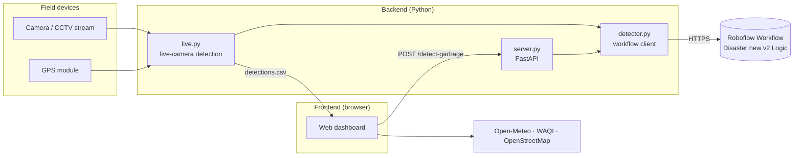

<div align="center">

# Post-Disaster Surface Garbage Recognition

**GIS watershed analysis and YOLO object detection for post-typhoon garbage mapping — a case study of Macau**

English · [繁體中文](README.zh-Hant.md)


</div>

## Overview

After a typhoon, debris collects in low-lying areas where surface runoff converges. This project combines prediction and detection to help cleanup crews find it faster:

1. **Predict.** GIS watershed analysis of Macau's 5 m digital elevation model (DEM) identifies depressions and runoff convergence zones where garbage is likely to accumulate.
2. **Detect.** A YOLOv12 model, served by a [Roboflow Workflow](#detection-model), recognises garbage in images from CCTV, phones or field cameras, and every detection is geotagged.
3. **Map.** A web dashboard plots detections as markers and a heatmap, alongside live weather, air quality, typhoon shelters and a disaster simulator.

Together these form a *pre-disaster prediction → in-disaster monitoring → post-disaster assessment* workflow.

> [!TIP]
> **The website is fully bilingual.** It opens in **English**; switch to **Traditional Chinese (繁體中文)** and back at any time with the language button in the top-right corner, on the intro screen or in the navigation bar. All text is translated instantly without reloading, including the map, weather, air quality, shelter names and response tips.

## Features

| Area | Capabilities |
| --- | --- |
| **Garbage recognition** | Capture a frame in the browser and detect garbage through the backend API, or run continuous detection on a camera or stream with GPS-tagged CSV logging |
| **Distribution map** | Leaflet map with category filters, a weighted heatmap, click-to-report, and CSV import/export |
| **District previews** | Mini-maps of 10 parishes and districts across the peninsula, the islands and new areas; click one to move the main map there |
| **Weather and air quality** | Current conditions plus 7-day and hourly forecasts (Open-Meteo); live AQI refreshed every 15 minutes (WAQI) |
| **Disaster simulation** | Compose scenarios from Macau's typhoon signals, storm-surge and rainstorm warnings |
| **Preparedness** | Typhoon shelters for each parish and response tips for six disaster types |
| **Chinese ↔ English translation** | One-click switch between Traditional Chinese and English across the whole site, with no page reload; dates, times and weekdays follow the selected language |

## Architecture



## Repository structure

```text
.
├── backend/
│   ├── garbage_detection/
│   │   ├── config.py           # Paths and defaults
│   │   ├── detector.py         # Roboflow Workflow client and per-class counting
│   │   ├── geo.py              # Serial GPS and simulated location sources
│   │   ├── records.py          # CSV detection log
│   │   ├── live.py             # CLI: real-time camera detection
│   │   └── server.py           # HTTP API for the dashboard
│   ├── tests/                  # Unit tests, plus a live workflow smoke test
│   ├── pyproject.toml          # Ruff and pytest configuration
│   ├── requirements.txt
│   └── requirements-dev.txt
├── frontend/
│   ├── index.html
│   ├── css/styles.css
│   └── js/
│       ├── main.js             # Entry point
│       ├── config.js           # API endpoints and map settings
│       ├── i18n/               # Translation engine and dictionaries (zh, en)
│       ├── data/               # Garbage taxonomy, districts, shelters, weather codes
│       ├── features/           # One module per dashboard feature
│       └── utils/              # DOM, CSV and random helpers
└── data/
    └── gis/
        └── cadmapper-macau-mo.zip  # 3D city model of Macau (SketchUp, from CADMapper)
```

## Getting started

### Prerequisites

- Python 3.9 or later
- A modern browser (Chrome, Edge, Firefox or Safari)
- A Roboflow API key, for detection (see below)
- Optional: a webcam or video stream, and a serial GPS module

### 1. Web dashboard

The dashboard is a static site built on ES modules, so it must be served over HTTP rather than opened from the file system:

```bash
python3 -m http.server 8080 --directory frontend
```

Open <http://localhost:8080> and choose **Garbage Recognition** or **Garbage Distribution**. The site opens in English; click **中文** in the top-right corner to switch to Traditional Chinese (and **English** to switch back). Everything except camera recognition works without the backend.

Translations live in `frontend/js/i18n/zh.js` and `frontend/js/i18n/en.js`. To add or change text, edit both dictionaries with the same key.

### 2. Detection API

Camera recognition mode sends captured frames to this API, which runs them through the [Roboflow Workflow](#detection-model). Copy your private API key from <https://app.roboflow.com/settings/api> and export it as `ROBOFLOW_API_KEY`. Never commit it; `.env` is git-ignored if you keep it in one.

```bash
cd backend
python3 -m venv .venv
source .venv/bin/activate
pip install -r requirements.txt
export ROBOFLOW_API_KEY=...   # Windows: set ROBOFLOW_API_KEY=...
uvicorn garbage_detection.server:app --port 8000
```

| Endpoint | Description |
| --- | --- |
| `GET /health` | Service status and the Roboflow Workflow in use |
| `POST /detect-garbage` | Multipart image upload in the `file` field; returns `{"detections": [{"type": "Drink container", "count": 2}]}`. Responds `502` if the workflow cannot be reached |

The dashboard calls `http://localhost:8000` by default (see `frontend/js/config.js`). Browser origins allowed by CORS default to `http://localhost:8080` and `http://127.0.0.1:8080`; override them with the comma-separated `CORS_ALLOW_ORIGINS` environment variable.

### 3. Live camera detection

```bash
cd backend
export ROBOFLOW_API_KEY=...
python -m garbage_detection.live --source 0 --gps-port COM3
```

The preview window shows the live feed. Every `--log-interval` seconds one frame is sent to the Roboflow Workflow, and its boxes are drawn on the preview until the next sample. Each sample is one serverless call, so a longer interval costs fewer credits. If a call fails, the frame is skipped and the camera keeps running.

| Option | Default | Description |
| --- | --- | --- |
| `--source` | `0` | Camera index or stream URL, e.g. an ESP32-CAM at `http://192.168.50.10:81/stream` |
| `--gps-port` | none | Serial port of a GPS module that prints `longitude,latitude` lines. If omitted or unavailable, positions are simulated within Macau |
| `--baud-rate` | `115200` | GPS baud rate |
| `--output` | `data/detections.csv` | CSV log to append to |
| `--confidence` | `0.25` | Discard detections below this confidence (applied after the workflow's own threshold) |
| `--log-interval` | `1.0` | Seconds between frames sent to the workflow and logged |

Press <kbd>q</kbd> in the preview window to stop, then load the CSV into the dashboard with **Import Data (CSV)**.

### CSV format

The live logger and the dashboard's import/export share one format:

```csv
id,type,latitude,longitude,count,timestamp
3f2b9c41d0e84b6f9a7c2e5d18a0b6c3,Drink container,22.198700,113.543900,2,2025-09-24T10:30:00+08:00
```

`type` is either a model class (see [Detection model](#detection-model)) or a manual report type (`Kitchen`, `Hazardous`, `Large`). Other values, such as classes from earlier models, are shown under *Other waste*, so a workflow with different classes works without code changes.

### Tests and linting

```bash
cd backend
pip install -r requirements-dev.txt
pytest
ruff check .
```

The unit tests replay a recorded workflow response and need no network. `tests/test_workflow_smoke.py` calls the live workflow on a sample image and checks its output keys; it runs only when `ROBOFLOW_API_KEY` is set and is skipped otherwise.

## Model

### Research results

The detector described in our research is a **YOLOv12** model that recognises **14 classes** of post-typhoon garbage:

- **Small land-based waste:** can, cardboard, carton, cloth, food leftover, glass bottle, paper bag, paper cup, paper food container, pile of leaves, plastic bag, plastic bottle, plastic food packaging
- **Large waste:** fallen tree

It was trained for 300 epochs (best at epoch 255). The augmentations were horizontal flips, noise injection, and 10° and 20° counter-clockwise rotations. Classes were resampled to balance the training set.

| Precision | Recall | mAP@50 | F1 |
| :-: | :-: | :-: | :-: |
| 89.5% | 82.8% | 86.8% | 86.0% |

<details>
<summary>Per-class mAP@50 (%)</summary>

| Class | mAP@50 | Class | mAP@50 |
| --- | :-: | --- | :-: |
| Can | 98 | Paper bag | 98 |
| Cardboard | 94 | Paper cup | 98 |
| Carton | 97 | Paper food container | 97 |
| Cloth | 99 | Pile of leaves | 72 |
| Fallen tree | 54 | Plastic bag | 82 |
| Food leftover | 93 | Plastic bottle | 95 |
| Glass bottle | 88 | | |

</details>

### Detection model

Detection runs on the Roboflow Workflow **Disaster new v2 Logic** (`disaster-ial0o/disaster-new-v2-logic`) on Roboflow's serverless API; no weights are stored in this repository. The workflow takes one input, `image`, and has no other parameters. It wraps the `disaster-new` workflow, which runs the YOLOv12n model `disaster-new/2` (precision 89.5%, recall 82.8%, mAP@50 86.8%).

Its single output, `predictions`, holds object detections. `backend/garbage_detection/detector.py` reads only each box's `class`, `confidence`, `x`, `y` (box centre), `width` and `height`:

```json
[{"predictions": {"image": {"width": 640, "height": 640},
                  "predictions": [{"class": "Drink container", "confidence": 0.78,
                                   "x": 323, "y": 406, "width": 30, "height": 42, "...": "..."}]}}]
```

The model's dataset merges some research classes, so it detects **11 classes**: `Can`, `Cardboard`, `Carton`, `Cloth`, `Drink container`, `Fallen tree`, `Food leftover`, `Food packaging`, `Glass bottle`, `Pile of Leaves` and `Useless bag`.

From Python, call `run_disaster_workflow(create_client(), image)`. It accepts a BGR `numpy` image, a file path or an https URL. Each call has a 30 s timeout and up to 2 retries with exponential backoff for timeouts, connection errors and HTTP 429/5xx. Failures raise `WorkflowError` subclasses: `WorkflowConfigError` (no API key), `WorkflowRequestError` / `WorkflowTimeoutError`, and `WorkflowResponseError` (unexpected payload).

## GIS findings

**Terrain curvature.** Concave terrain (curvature < 0) covers about **14.3%** of the Macau Peninsula, mainly around the Inner Harbour, Praia do Manduco and Ilha Verde. During heavy rain, surface runoff, and the debris it carries, converges in these natural depressions first.

**Elevation.** Land below 2 m makes up **29%** of Macau's land area, and some local depressions lie 0.5 m below sea level. Tidal backwater makes flooding in these areas worse.

**High-risk areas**

1. **Inner Harbour**: average elevation 1.2 m
2. **Ilha Verde**: natural depression
3. **Praia do Manduco**: low-lying area
4. **Toi San, Iao Hon, Areia Preta, Fai Chi Kei**: relatively low terrain
5. **Rua do Mercado, Lam Mau Tong, Patane, San Kio**: dense building areas

## Roadmap

- **Model:** add night, low-visibility and rain imagery to the dataset; use transfer and self-supervised learning to reduce labelling effort; add BeiDou positioning for finer localisation.
- **Robotic cleanup:** plan cleanup routes from the heatmap and detections; send heavy robots for fallen trees and construction waste and light robots for small debris.
- **Public participation:** pair a mobile app with street CCTV for real-time detection, and show cleanup progress to the public.
- **Greater Bay Area:** share terrain and detection data across Macau, Hong Kong and Shenzhen for regional impact assessment and resource allocation.

## References

**Chinese**

- 林怡君、莊諶雄 (2018). 澳門天鴿與山竹颱風的災害分析與因應策略. 澳門大學.
- 地球物理暨氣象局 (2019). 《澳門防災減災規劃 (2019–2028 年)》. 澳門特別行政區政府.
- 澳門環境保護局 (2023). 《澳門環境狀況報告 2023》. 澳門特別行政區政府.
- 黃少敏 (1990). 澳門地貌概要. Macau Data.

**English**

- Bennett, G. (2025). A review of the data used to validate groundwater recharge maps created with GIS techniques over the past two decades. *HydroResearch*, 8, 276–285.
- Han, W., Feng, R., Wang, L., & Cheng, Y. (2020). A semi-supervised generative framework with deep learning features for high-resolution remote sensing image scene classification. *ISPRS Journal of Photogrammetry and Remote Sensing*, 167, 58–74.
- Jiang, P., Ergu, D., Liu, F., Cai, Y., & Ma, B. (2022). A review of YOLO algorithm developments. *Procedia Computer Science*, 199, 1066–1073.
- Karuppasamy, M., Wang, H. P., Koh, J. Y., Wang, H., & Yeong, C. F. (2022). An automated solid waste detection using the optimized YOLO model for riverine management. *Frontiers in Public Health*, 10, 907280.
- Rajmohan, M., Reshmi, E., Satyanand, P. V., & Vishnu, K. (2023). Advanced YOLO-based trash classification and recycling assistant for enhanced waste management and sustainability. *Advances in Sustainability Science and Technology*, 185–196.
- Wang, L., Wu, Z., Zhang, W., Wang, X., & Feng, W. (2025). Dynamic life cycle environmental impact assessment for urban built environment based on BIM and GIS. *Energy and Buildings*, 333, 115445.

## Team

Ao Chun Meng · Leong Hou Wang · Sao Cheng Tai · Sam U Hin · Wong Chi Yu

## License

Licensed under the [GNU Affero General Public License v3.0](https://www.gnu.org/licenses/agpl-3.0.html), the same license as Ultralytics YOLO.

## Acknowledgements

We thank the departments of the Macau SAR Government for the public data and literature that supported this work. Map data © OpenStreetMap contributors. Weather data comes from Open-Meteo and air quality data from the World Air Quality Index Project.

> [!IMPORTANT]
> This is a research project. Any deployment must comply with applicable laws, regulations and privacy policies, particularly when processing CCTV footage.
