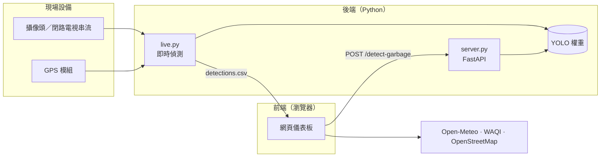

<div align="center">

# 颱風災後地表垃圾智慧辨識系統

**融合 GIS 流域解析與 YOLO 深度學習模型的颱風災後地表垃圾辨識方案 —— 以澳門為例**

[English](README.md) · 繁體中文


</div>

## 項目簡介

颱風過後，垃圾容易堆積在地表徑流匯聚的低窪地區。本項目結合預測與偵測兩種手段，協助清理隊伍更快找到垃圾：

1. **預測**：以澳門 5 米分辨率數字高程模型（DEM）進行 GIS 流域分析，找出地表凹陷與徑流匯聚帶，即垃圾堆積的高風險區域。
2. **偵測**：利用 YOLO 模型在閉路電視、手機或現場攝像頭的影像中識別垃圾，並為每次偵測標註地理位置。
3. **佈點**：在網頁儀表板上以標記及熱力圖顯示垃圾分佈，同時提供實時天氣、空氣品質、避險中心及災害模擬資訊。

三者構成「災前預測－災中監控－災後評估」的全鏈條管理方案。

## 主要功能

| 範疇 | 功能 |
| --- | --- |
| **垃圾識別** | 在瀏覽器拍攝畫面並經後端 API 識別垃圾；或對攝像頭／影像串流進行連續偵測，並將附有 GPS 位置的結果記錄至 CSV |
| **垃圾分佈地圖** | 基於 Leaflet 的地圖，支援按類別篩選、加權熱力圖、點擊地圖報告垃圾及 CSV 匯入匯出 |
| **區域預覽** | 各堂區及區域的小地圖；點擊即可將主地圖移至該區 |
| **天氣與空氣品質** | 當前天氣、未來七日及逐小時預報（Open-Meteo）；每 15 分鐘自動刷新的實時空氣品質指數（WAQI） |
| **災害模擬** | 以澳門颱風信號、風暴潮及暴雨警告組合模擬情境 |
| **防災資訊** | 各堂區避險中心，以及六類災害的應對要點 |
| **中英文翻譯** | 網站預設為英文，一鍵切換至繁體中文，無需重新載入；日期、時間及星期亦隨所選語言顯示 |

## 系統架構



## 項目結構

```text
.
├── backend/
│   ├── garbage_detection/
│   │   ├── config.py           # 路徑與預設值
│   │   ├── detector.py         # YOLO 封裝及按類別計數
│   │   ├── geo.py              # 串口 GPS 及模擬定位
│   │   ├── records.py          # CSV 偵測記錄
│   │   ├── live.py             # 命令列工具：即時攝像頭偵測
│   │   └── server.py           # 供儀表板使用的 HTTP API
│   ├── tests/
│   ├── pyproject.toml          # Ruff 與 pytest 設定
│   ├── requirements.txt
│   └── requirements-dev.txt
├── frontend/
│   ├── index.html
│   ├── css/styles.css
│   └── js/
│       ├── main.js             # 程式入口
│       ├── config.js           # API 端點與地圖設定
│       ├── i18n/               # 翻譯引擎與字典（中、英）
│       ├── data/               # 垃圾分類、區域、避險中心、天氣代碼
│       ├── features/           # 每個儀表板功能一個模組
│       └── utils/              # DOM、CSV 及隨機數工具
├── models/
│   ├── best.pt                 # 最佳權重（預設）
│   └── last.pt                 # 最後一輪權重
└── data/
    └── gis/
        └── cadmapper-macau-mo.zip  # 澳門 3D 城市模型（SketchUp，來自 CADMapper）
```

## 快速開始

### 環境要求

- Python 3.9 或以上
- 現代瀏覽器（Chrome、Edge、Firefox 或 Safari）
- 可選：網絡攝像頭或影像串流，以及串口 GPS 模組

### 1. 網頁儀表板

儀表板是基於 ES 模組的靜態網站，須經 HTTP 伺服器開啟，不能直接以檔案方式打開：

```bash
python3 -m http.server 8080 --directory frontend
```

打開 <http://localhost:8080>，選擇 **Garbage Recognition**（垃圾識別）或 **Garbage Distribution**（垃圾分佈）。網站預設以英文顯示，點擊右上角的 **中文** 按鈕即可切換至繁體中文（點擊 **English** 切換回英文）。除攝像頭識別外，所有功能均無需後端即可使用。

### 2. 偵測 API

攝像頭識別模式會將拍攝畫面傳送至此 API。

```bash
cd backend
python3 -m venv .venv
source .venv/bin/activate
pip install -r requirements.txt
uvicorn garbage_detection.server:app --port 8000
```

| 端點 | 說明 |
| --- | --- |
| `GET /health` | 服務狀態及模型類別名稱 |
| `POST /detect-garbage` | 以 multipart 上傳圖片（欄位 `file`），返回 `{"detections": [{"type": "Plastic", "count": 2}]}` |

儀表板預設呼叫 `http://localhost:8000`（見 `frontend/js/config.js`）。CORS 預設允許 `http://localhost:8080` 及 `http://127.0.0.1:8080`，可透過以逗號分隔的環境變數 `CORS_ALLOW_ORIGINS` 修改。

### 3. 即時攝像頭偵測

```bash
cd backend
python -m garbage_detection.live --source 0 --gps-port COM3
```

| 參數 | 預設值 | 說明 |
| --- | --- | --- |
| `--source` | `0` | 攝像頭編號或串流網址，例如 ESP32-CAM 的 `http://192.168.50.10:81/stream` |
| `--gps-port` | 無 | 輸出 `經度,緯度` 格式的 GPS 模組串口；未提供或無法連接時，會在澳門範圍內模擬位置 |
| `--baud-rate` | `115200` | GPS 波特率 |
| `--weights` | `models/best.pt` | YOLO 權重；亦可透過 `GARBAGE_MODEL_PATH` 設定 |
| `--output` | `data/detections.csv` | 追加寫入的 CSV 記錄檔 |
| `--confidence` | `0.25` | 最低偵測置信度 |
| `--log-interval` | `1.0` | 兩次記錄之間的最短秒數 |

在預覽視窗按 <kbd>q</kbd> 停止，然後在儀表板以 **匯入垃圾資料（CSV）** 載入記錄。

### CSV 格式

即時偵測記錄與儀表板的匯入匯出共用同一格式：

```csv
id,type,latitude,longitude,count,timestamp
3f2b9c41d0e84b6f9a7c2e5d18a0b6c3,Plastic,22.198700,113.543900,2,2025-09-24T10:30:00+08:00
```

`type` 為模型類別（`Glass`、`Metal`、`Plastic`、`Trash`）或手動報告類型（`Kitchen`、`Hazardous`、`Large`）。其他值會歸入「其他垃圾」，因此更換為不同類別的權重亦無需修改程式碼。

### 測試與程式碼檢查

```bash
cd backend
pip install -r requirements-dev.txt
pytest
ruff check .
```

## 模型

### 研究成果

研究中的偵測器為 **YOLOv12** 模型，可識別 **14 類** 颱風災後垃圾：

- **小型陸源垃圾**：罐頭、紙箱、小形紙盒、紡織品、廚餘、玻璃瓶、紙袋、紙杯、紙質食物包裝、樹葉堆、塑膠袋、塑膠瓶、塑膠食品包裝
- **大型垃圾**：倒塌樹木

模型訓練 300 輪，在第 255 輪達到最佳性能。數據增強採用水平翻轉、噪音注入及逆時針旋轉 10 度和 20 度，並對各類別重新取樣以平衡訓練集。

| 精確度 | 召回率 | mAP@50 | F1 |
| :-: | :-: | :-: | :-: |
| 89.5% | 82.8% | 86.8% | 86.0% |

<details>
<summary>各類別 mAP@50（%）</summary>

| 類別 | mAP@50 | 類別 | mAP@50 |
| --- | :-: | --- | :-: |
| 罐頭 (Can) | 98 | 紙袋 (Paper bag) | 98 |
| 紙箱 (Cardboard) | 94 | 紙杯 (Paper cup) | 98 |
| 小形紙盒 (Carton) | 97 | 紙質食物包裝 (Paper food container) | 97 |
| 紡織品 (Cloth) | 99 | 樹葉堆 (Pile of leaves) | 72 |
| 倒塌樹木 (Fallen tree) | 54 | 塑膠袋 (Plastic bag) | 82 |
| 廚餘 (Food leftover) | 93 | 塑膠瓶 (Plastic bottle) | 95 |
| 玻璃瓶 (Glass bottle) | 88 | | |

</details>

### 隨附權重

> [!NOTE]
> `models/` 內的權重**並非**上述 14 類研究模型，而是一個以海洋塑膠數據集、640 px 解像度訓練的 4 類 YOLO11n 模型（`Glass`、`Metal`、`Plastic`、`Trash`）。訓練於第 170 輪提前停止；`best.pt`（第 70 輪）在其驗證集上的 mAP@50 為 0.556，mAP@50-95 為 0.354。如需使用其他權重，可傳入 `--weights` 或設定 `GARBAGE_MODEL_PATH`。

## GIS 流域解析結果

**地形曲率。** 曲率低於 0 的凹形地形約佔澳門半島面積的 **14.3%**，主要分佈於內港、司打口及青洲一帶。暴雨期間，地表徑流及其攜帶的垃圾會優先匯聚於這些天然凹陷地形。

**海拔。** 海拔低於 2 米的土地佔澳門陸域面積的 **29%**，部分局部凹陷處更低於海平面 0.5 米，潮汐頂托作用會令這些地區的積水更為嚴重。

**高風險區域**

1. **內港**：平均海拔 1.2 米
2. **青洲**：天然凹陷地帶
3. **司打口**：低窪區域
4. **台山、祐漢、黑沙環、筷子基**：地勢較低
5. **紅街市、林茂塘、沙梨頭、新橋**：建築密集區

## 未來展望

- **模型**：擴充夜間、低能見度及雨天影像；引入遷移學習與自監督學習以減少標註工作；整合北斗衛星定位以提升定位精度。
- **機器人清理**：根據熱力圖及偵測結果規劃清理路徑；由重型機器人處理倒塌樹木及建築廢料，輕型機器人處理小型垃圾。
- **公眾參與**：開發配合街道閉路電視即時偵測的移動應用程式，並向公眾展示清理進度。
- **大灣區合作**：澳門、香港、深圳共享地勢及偵測數據，提供區域性災害影響評估與資源調配建議。

## 參考文獻

**中文文獻**

- 林怡君、莊諶雄 (2018). 澳門天鴿與山竹颱風的災害分析與因應策略. 澳門大學.
- 地球物理暨氣象局 (2019). 《澳門防災減災規劃 (2019–2028 年)》. 澳門特別行政區政府.
- 澳門環境保護局 (2023). 《澳門環境狀況報告 2023》. 澳門特別行政區政府.
- 黃少敏 (1990). 澳門地貌概要. Macau Data.

**英文文獻**

- Bennett, G. (2025). A review of the data used to validate groundwater recharge maps created with GIS techniques over the past two decades. *HydroResearch*, 8, 276–285.
- Han, W., Feng, R., Wang, L., & Cheng, Y. (2020). A semi-supervised generative framework with deep learning features for high-resolution remote sensing image scene classification. *ISPRS Journal of Photogrammetry and Remote Sensing*, 167, 58–74.
- Jiang, P., Ergu, D., Liu, F., Cai, Y., & Ma, B. (2022). A review of YOLO algorithm developments. *Procedia Computer Science*, 199, 1066–1073.
- Karuppasamy, M., Wang, H. P., Koh, J. Y., Wang, H., & Yeong, C. F. (2022). An automated solid waste detection using the optimized YOLO model for riverine management. *Frontiers in Public Health*, 10, 907280.
- Rajmohan, M., Reshmi, E., Satyanand, P. V., & Vishnu, K. (2023). Advanced YOLO-based trash classification and recycling assistant for enhanced waste management and sustainability. *Advances in Sustainability Science and Technology*, 185–196.
- Wang, L., Wu, Z., Zhang, W., Wang, X., & Feng, W. (2025). Dynamic life cycle environmental impact assessment for urban built environment based on BIM and GIS. *Energy and Buildings*, 333, 115445.

## 研究團隊

Ao Chun Meng · Leong Hou Wang · Sao Cheng Tai · Sam U Hin · Wong Chi Yu

## 授權

本項目採用 [GNU Affero General Public License v3.0](https://www.gnu.org/licenses/agpl-3.0.html) 授權，與 Ultralytics YOLO 相同。

## 致謝

感謝澳門特別行政區政府相關部門提供的公開數據與文獻支持。地圖數據 © OpenStreetMap 貢獻者；天氣數據來自 Open-Meteo；空氣品質數據來自世界空氣品質指數項目（WAQI）。

> [!IMPORTANT]
> 本系統為研究項目。實際部署須遵守相關法律法規及私隱政策，處理閉路電視影像時尤須注意。
